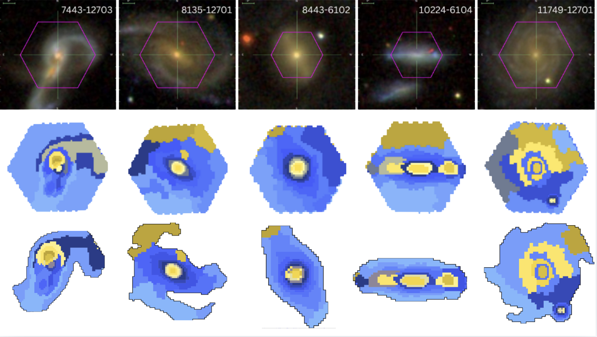
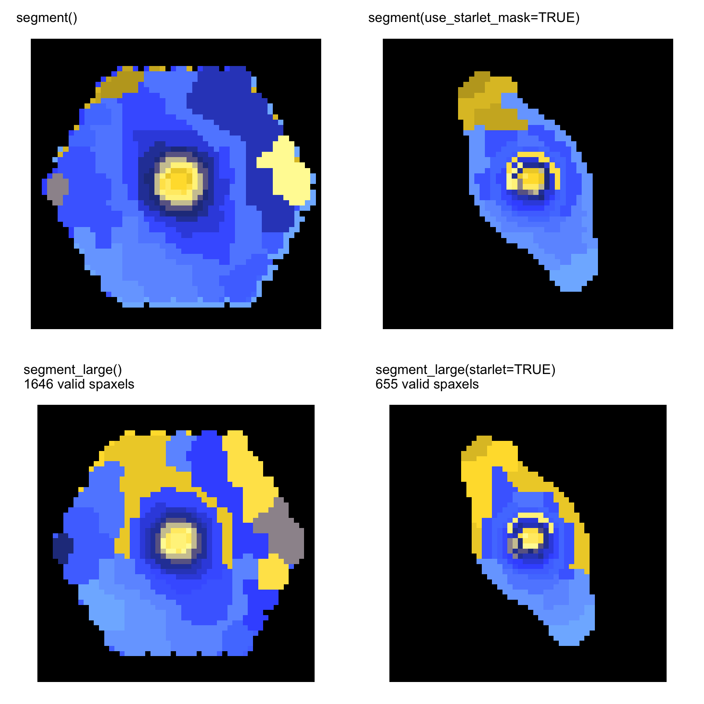

# Explore galaxies with Capivara

Every galaxy has a different spectral landscape. A bright nucleus, a faint
disc or a star-forming knot may look very different when you compare their
spectra. Explore how Capivara groups these observations into regions, and
take the same approach to your own data.

[Get started](../vignettes/getting-started.Rmd) ·
[Analyse your own data](../vignettes/your-own-data.Rmd) ·
[Documentation](https://rafaelsdesouza.com.br/capivara/)

## Explore MaNGA

The maps show regions derived from real integral-field observations. Each
colour identifies a region with similar spectra; the colours are categorical,
not a scale of brightness or physical properties.

### A closer look at MaNGA 8443-6102

Compare the exact and sparse-graph algorithms, with and without a Starlet
support mask. This is a useful example if you want to understand how your
choice of segmentation method or footprint changes the result.

[Read the example](../vignettes/examples.Rmd) ·
[Choose a segmentation method](../vignettes/choosing-segmentation-backend.Rmd)

### Work with MaNGA 8602-12705

Use this disc galaxy to try the local-data workflow. It is one of the five
objects in our [spatial segmentation validation](../SPATIAL_FOUNDATION_V4_FREEZE.md).
You can obtain the original observations through the [SDSS DR17 archive](https://www.sdss4.org/dr17/manga/manga-data/data-access/).

The archive naming convention gives the following file paths (check their
availability in the archive):

- [DRP spectral cube](https://data.sdss.org/sas/dr17/manga/spectro/redux/v3_1_1/8602/stack/manga-8602-12705-LOGCUBE.fits.gz)
- [DAP maps](https://data.sdss.org/sas/dr17/manga/spectro/analysis/v3_1_1/3.1.0/HYB10-MILESHC-MASTARSSP/8602/12705/manga-8602-12705-MAPS-HYB10-MILESHC-MASTARSSP.fits.gz)

Follow [Analyse your own data](../vignettes/your-own-data.Rmd) to prepare
the cube and extract regional spectra. DAP maps are survey measurements,
not Capivara fits. If you compare the two, check their WCS and pixel alignment
first.

## Explore other surveys

Interested in spiral structure, gas stripping or AGN feedback? The following
targets are planned for the multi-survey gallery. The links lead to their
observational programmes; Capivara results are not yet available for these
examples.

| Galaxy | Observations | What to explore |
| --- | --- | --- |
| NGC 628 | [PHANGS / MUSE](https://www.phangs.org/data) | Spiral structure and H II regions |
| NGC 5485 | [CALIFA](https://califa.caha.es/DR3/) | Unusual stellar rotation |
| JO206 | [GASP / MUSE](https://archive.eso.org/scienceportal/home) | Gas stripping and extraplanar star formation |
| NGC 5643 | [MAGNUM / MUSE](https://archive.eso.org/scienceportal/home) | Nuclear ionized gas and outflows |
| CATID 272822 | [SAMI](https://datacentral.org.au/) | Stellar–gas kinematic misalignment |

## Try it yourself

You do not need a large survey cube to get started. The tutorial includes a
small synthetic galaxy and a workflow for local observations. For a large MUSE
mosaic, start with a region of scientific interest and retain its WCS and
coverage information.

The original FITS data stay in their survey archives. Use the example scripts
and documented input conventions to reproduce your own maps and spectra.

[Install Capivara and run your first analysis](../vignettes/your-own-data.Rmd)
