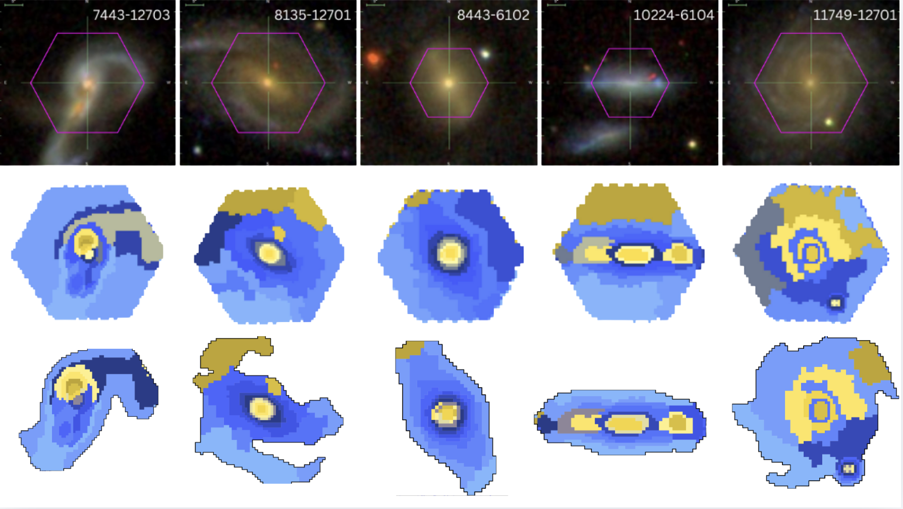
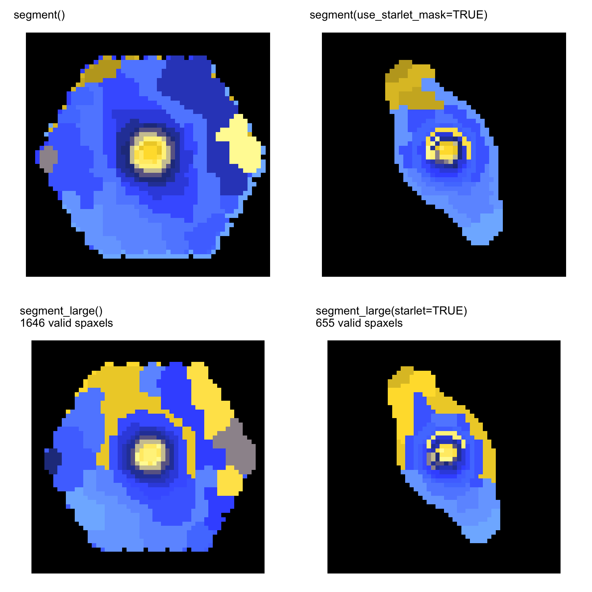

```{r setup, include=FALSE}
knitr::opts_chunk$set(collapse=TRUE, comment="#>")
```

What can you learn about a galaxy by comparing its spectra across the sky? Explore these examples from real MaNGA observations, compare different ways of defining regions, and use the same tools on your own data.

Open the [Galaxy Atlas collection](../atlas/gallery.html) to browse individual observed examples and compare their region maps. The current observational collection displays the original figures; the interactive numerical workspace uses exported spectra and labels.

## Explore the MaNGA galaxy collection

<figure class="science-figure">

<figcaption>Real MaNGA inputs and Capivara region maps. Colours identify regions and do not represent an ordered quantity.</figcaption>
</figure>

The panels show the IFS cube, spatial support, and spectral regions. Use
`summarize_cluster_spectra()` to obtain the summed regional spectra.

## Compare two segmentation methods

<figure class="science-figure">

<figcaption>MaNGA 8443-6102 segmented with `segment()` and `segment_large()`, with and without starlet support.</figcaption>
</figure>

Want to reproduce a similar map? For a FITS file whose flux HDU and spectral axes you have already checked, the original segmentation workflow is:

```{r real-template, eval=FALSE}
library(capivara)
library(FITSio)

cube <- FITSio::readFITS("/path/to/input_cube.fits")

seg <- segment_large(
  input = cube,
  Ncomp = 25,
  use_starlet_mask = TRUE,
  starlet_J = 5,
  starlet_scales = 2:5,
  include_coarse = FALSE,
  denoise_k = 0,
  positive_only = TRUE,
  mask_mode = "na",
  knn_k = 100
)

regional_spectra <- summarize_cluster_spectra(seg)$sum_spectra
```

Replace the path with your local, verified flux cube. To include measurement variance, quality masks and explicit spectral geometry, follow [Analyse your own data](your-own-data.html). If you are new to Capivara, start with the [runnable simulation](getting-started.html).

## Explore the motions of gas

The [Kinematic
Analysis](https://rafaelsdesouza.com.br/capivara/articles/kinematic-analysis.html)
guide covers line maps and an axisymmetric disc model. The [Bar
Model](https://rafaelsdesouza.com.br/capivara/articles/bisymmetric-bar-model.html)
guide adds bisymmetric terms for a known barred galaxy.

## Explore other observing programmes

Interested in a MUSE spiral, a jellyfish galaxy or an active nucleus? The [GitHub example gallery](https://github.com/RafaelSdeSouza/capivara/tree/docs/reproducible-atlas-examples/examples) introduces the planned targets and links to their survey archives. Interactive Capivara results for those targets are not yet available.
